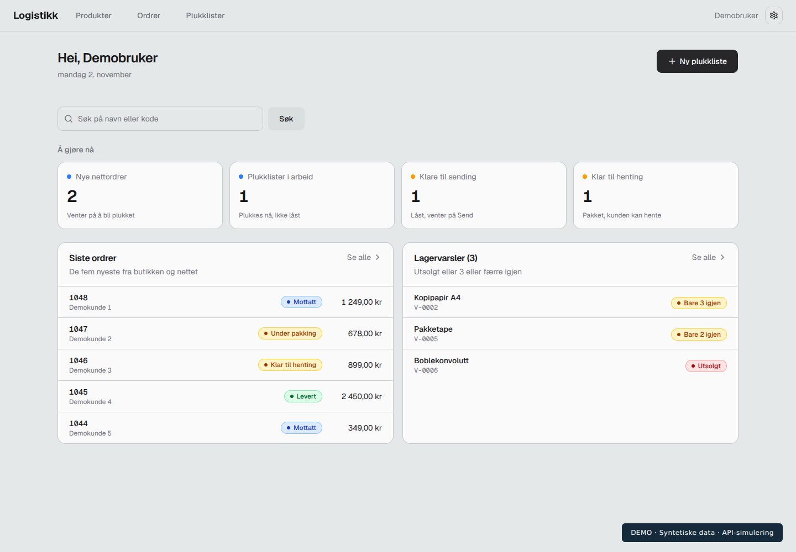
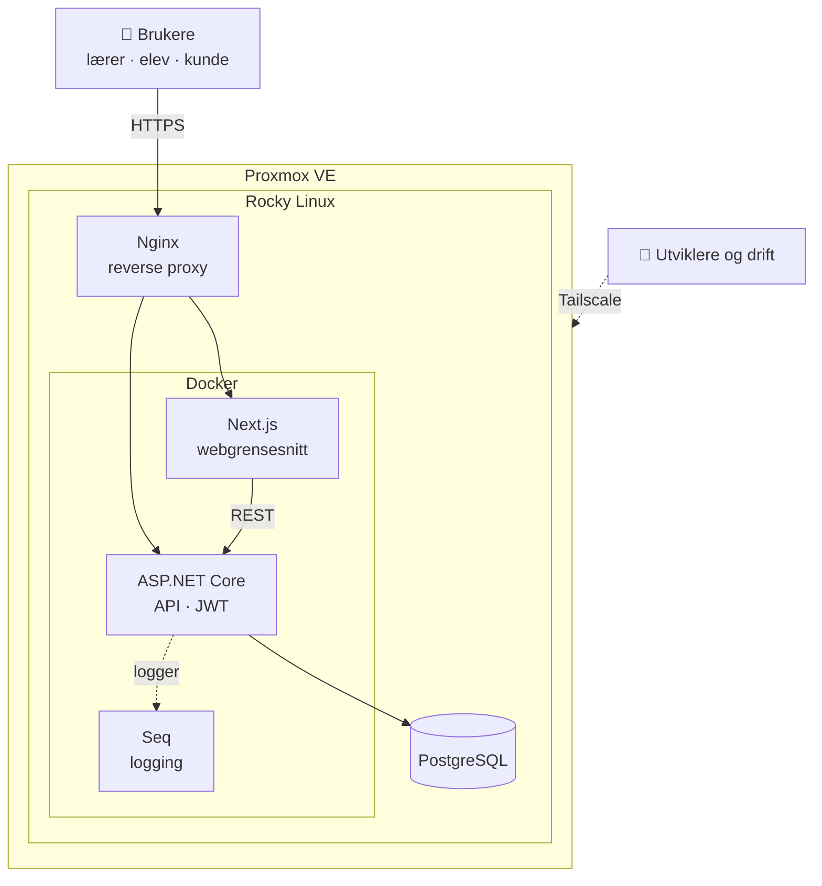
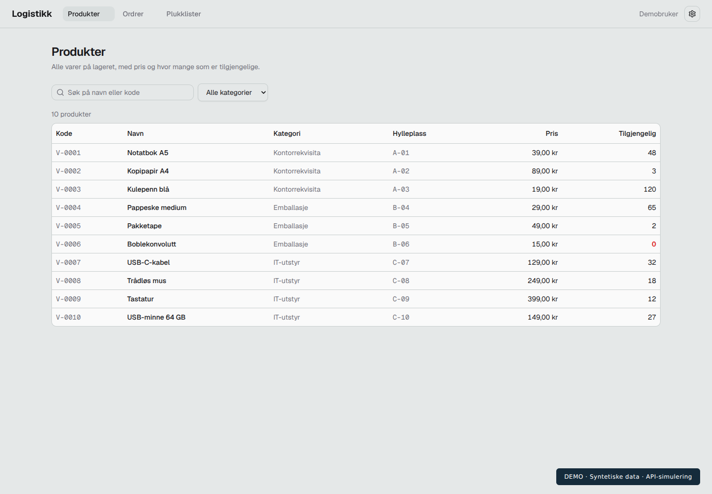
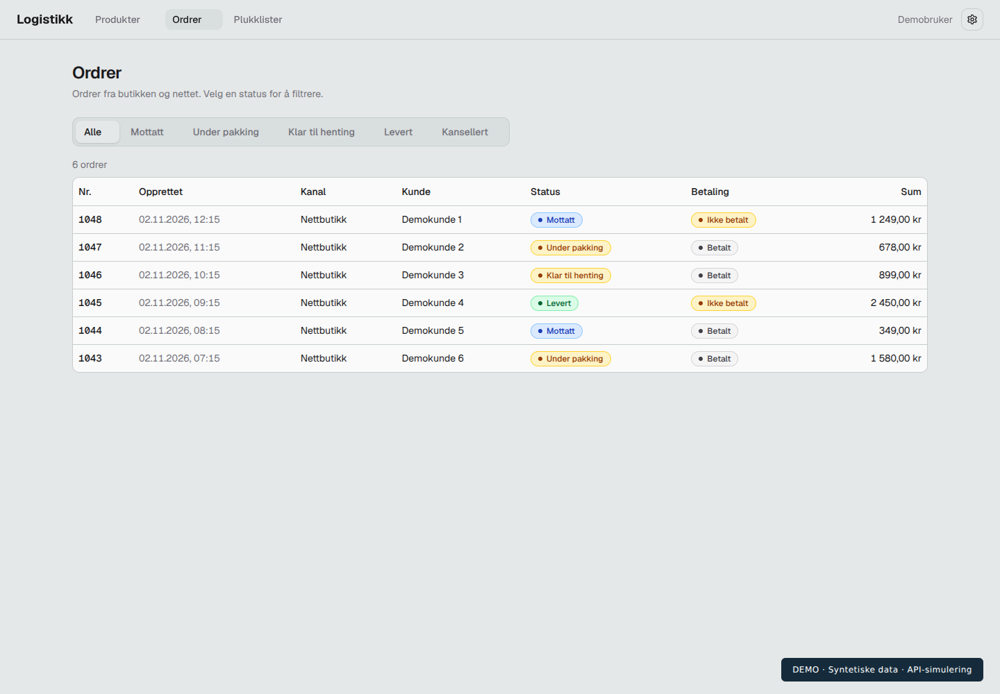
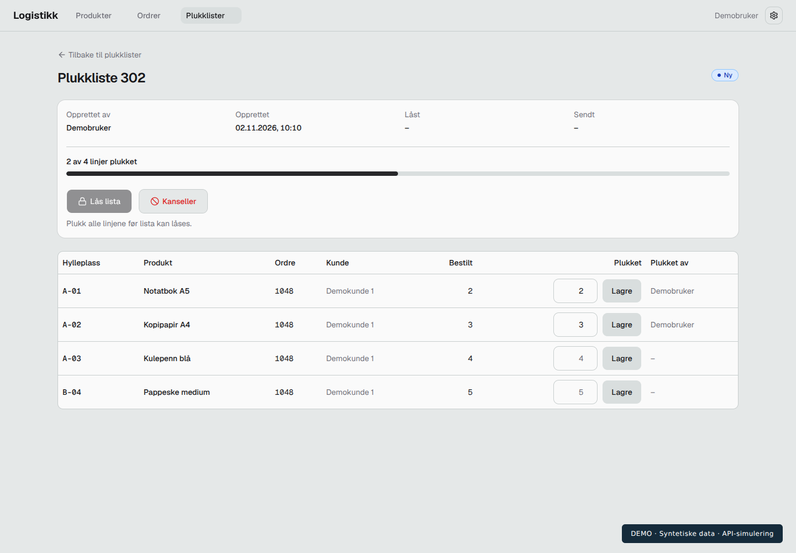
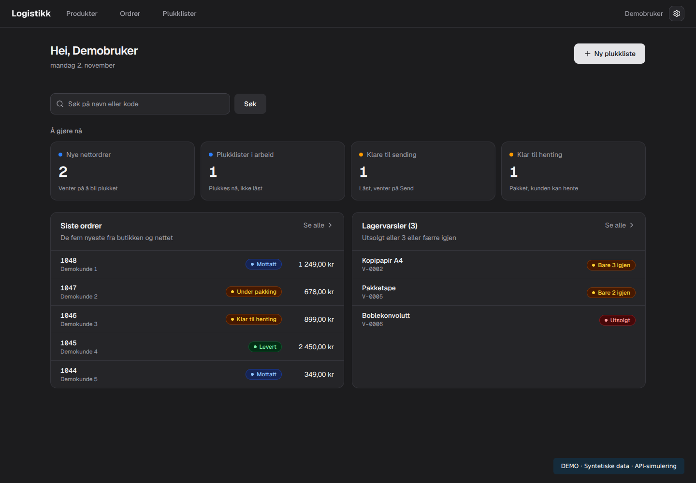

# LOGISTIKK
### Fra lageroversikt til plukkliste

Lager- og logistikksystem for en ekte oppdragsgiver, med backend, database og egen server satt opp fra bunnen av.

[Skjermbilder](#skjermbilder) · [Serveroppsett](#serveroppsett-og-drift) · [Last ned demo](assets/Logistikk-demo.mp4) · [LinkedIn](https://www.linkedin.com/in/ali-badr-a-a-almrabhi-5676b9448/)

> [!NOTE]
> Bildene viser prosjektets faktiske Next.js-grensesnitt med syntetiske data fra et simulert API. Videoen er en 30 sekunders presentasjon av skjermbildene, uten lyd. Materialet dokumenterer grensesnittet, ikke en full ende-til-ende-test av backend.

## Hva er Logistikk?

Logistikk er et skoleprosjekt på Vg2 IT-utvikling ved Åssiden videregående skole, utviklet for en **ekte oppdragsgiver**: en butikk der elever jobber, som i dag holder oversikt over varer i Excel og ønsker en bedre løsning.

Målet er en forståelig arbeidsflyt: finne en vare, se lagerstatus, følge en ordre og registrere plukkede varer.

## Mitt bidrag

Jeg har hovedansvar for **backend og server**, og har også arbeidet med webgrensesnittet.

| Område | Hva jeg har gjort |
| --- | --- |
| 🖥️ **Server og drift** | Satte opp serveren fra bunnen av: Proxmox, Rocky Linux, Docker, Nginx, Seq og Tailscale |
| ⚙️ **Backend** | API i C# og ASP.NET Core (.NET 10), innlogging med JWT og rollebasert tilgang |
| 🗄️ **Database** | PostgreSQL, datamodeller og migreringer |
| 🌐 **Web** | Next.js-grensesnitt for produkter, ordrer og plukklister |
| 📄 **Samarbeid** | Dokumentasjon og tilkoblingsveiledning for resten av prosjektgruppen |

Prosjektet er et gruppearbeid. Denne presentasjonen beskriver mitt bidrag og utvalgte deler av løsningen.

## Serveroppsett og drift

Hele miljøet kjører på en server jeg har installert og konfigurert selv.

| Komponent | Rolle |
| --- | --- |
| **Proxmox VE** | Virtualisering, kjører serveren som virtuell maskin |
| **Rocky Linux** | Operativsystem for serveren |
| **Docker** | Kjører tjenestene i containere |
| **Nginx** | Reverse proxy foran webgrensesnitt og API |
| **Seq** | Strukturert logging fra API-et, brukt til feilsøking |
| **Tailscale** | Sikker tilgang til serveren uten åpne porter |

## Funksjoner i grensesnittet

| Område | Hva visningen viser |
| --- | --- |
| 📊 Oversikt | Oppgaver, nyeste ordrer og varer med lav beholdning |
| 📦 Produkter | Søk, kategorier, pris, hylleplass og tilgjengelig antall |
| 🧾 Ordrer | Filtrering etter status og oversikt over betaling |
| ✅ Plukklister | Varelinjer, registrering av antall og fremdrift |
| 🎨 Tilpasning | Bokmål, nynorsk og engelsk; lyst, mørkt og blått tema |

## Skjermbilder

### Produkter og lager

### Ordreoversikt

### Plukking og fremdrift

<strong>Se grensesnittet i mørkt tema</strong>

## Teknisk oppbygning

| Del | Teknologi og ansvar |
| --- | --- |
| Webgrensesnitt | Next.js, React og TypeScript |
| API | C# og ASP.NET Core (.NET 10) |
| Tilgang | JWT og roller for lærer, elev og kunde |
| Datalagring | PostgreSQL |
| Drift | Proxmox, Rocky Linux, Docker, Nginx, Seq og Tailscale |

Webgrensesnittet kommuniserer med API-et, som håndterer tilgang, forretningsregler og lagring. Kildekoden ligger i separate, private repositorier.

## Hva jeg lærer

Å sette opp både applikasjonen og serveren den kjører på har gitt meg praktisk erfaring med hele kjeden, fra database og API til nettverk, logging og feilsøking i drift. Jeg arbeider videre med testing, tydelige feilmeldinger og dokumentasjon, og er særlig interessert i forbindelsen mellom backend og drift.

## Om dette repositoriet

Dette er et **presentasjonsrepo**. Det inneholder utvalgte skjermbilder og en kort video, men ingen privat kildekode, virkelige kundedata eller serverhemmeligheter. Det er ikke en installerbar versjon av applikasjonen.

**Status:** 🚧 Under utvikling · Skoleprosjekt · Demonstrasjon med syntetiske data

---

**Ali Badr Almrabhi** · Vg2 IT-utvikling · Åssiden videregående skole

Søker læreplass innen IT-utvikling eller IT-drift

[GitHub](https://github.com/AliPluss) · [LinkedIn](https://www.linkedin.com/in/ali-badr-a-a-almrabhi-5676b9448/)

